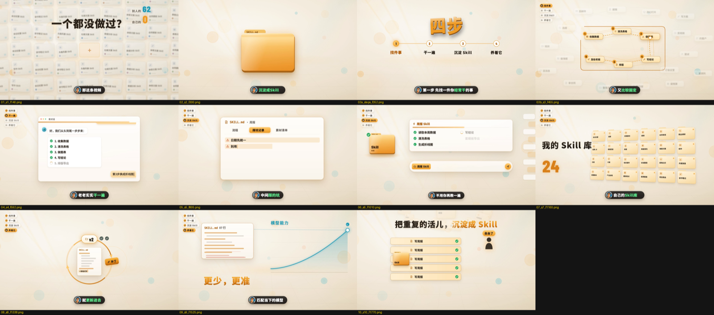

# talking-video-skills

一句话需求 → 口播 / 动效讲解视频成片。三个 Claude Code Skill + 方法论 + 可复用脚本。

 

上图为用本 Skill 做出的一条 60 秒纯动效视频（分镜总览与自动生成的封面）。

| 路径 | 内容 |
|---|---|
| `方法论.md` | 完整方法论：流程、数字人融合、纯动效、自检、踩坑 |
| `skills/talking-video-oneshot/` | **总入口 skill**：一句话需求 → 成片，自动推进，只在必须有人的环节停下 |
| `skills/combo-style/` | 口播片包装与协作（稿子、分镜、字幕、数字人、音效） |
| `skills/ae-motion-craft/` | 高级动效：规律（带数值）、拆解与复刻方法、与口播融合 |
| `pipeline-scripts/` | 可复用脚本：对齐、字幕、字幕同步核对、波形起音核对、抠像、看门狗渲染、音效、打字登记 |

## 安装
把 `skills/` 下三个文件夹放进 `~/.claude/skills/`，重启 Claude Code，说「帮我做一条关于 X 的视频」。

## 注意
- 本包**不含**动效积木源码（依赖原工程的主题与字体，单独跑不起来）。ae-motion-craft 里提到「积木目录」处，指你自己建的积木库，建法见 method-dissect.md。
- 文档中的博主名、项目名、本机路径已做通用化处理，个别措辞可能残留，使用前请通读。
- 脚本里的路径（whisper 虚拟环境等）按你的机器改。
